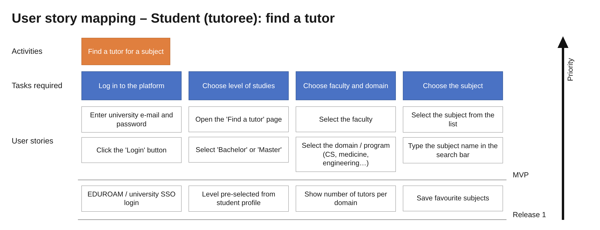
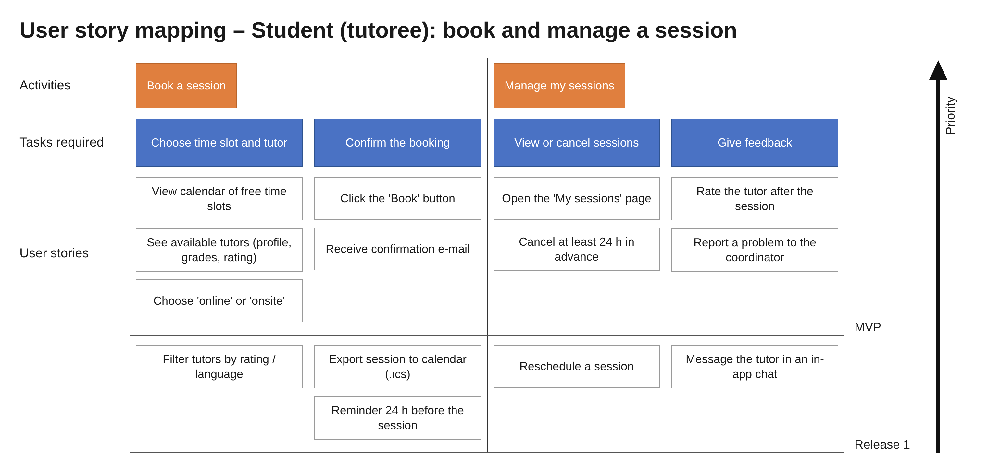
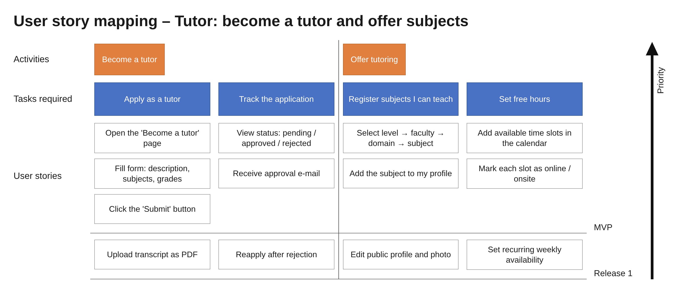
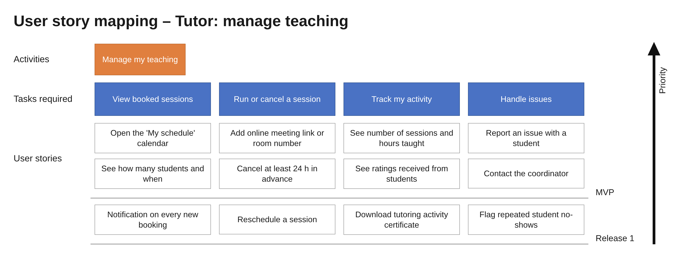
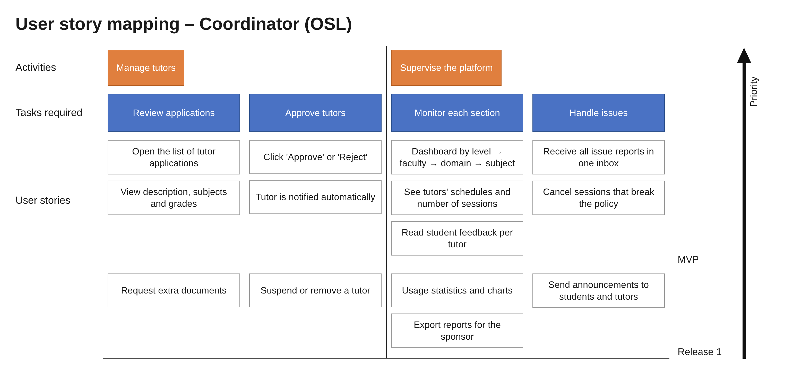

# 1.3 User Story Mapping (Anastasiia)

### User story mapping – Student (tutoree): find a tutor

### User story mapping – Student (tutoree): book and manage a session

### User story mapping – Tutor: become a tutor and offer subjects

### User story mapping – Tutor: manage teaching

### User story mapping – Coordinator (OSL)

# 1.4 Requirement Analysis

Requirements are derived from the stakeholder needs and checked against the user stories (S = Student, T = Tutor, C = Coordinator stories) and use cases. Priorities follow the MVP / Release 1 lines of the story maps (MoSCoW).

## Functional requirements

| ID | Requirement | Priority | Source |
|---|---|---|---|
| FR1 | The system shall let users log in with their university e-mail and password and open the dashboard of their role (Student, Tutor, Coordinator). | Must | All roles · UC01 |
| FR2 | The system shall let students search tutors by level, faculty, program and subject, showing only approved, active tutors with their rating and free time windows. | Must | S1 · UC02 |
| FR3 | The system shall let students request a session inside a tutor's free window by choosing a start time, a duration (30, 60, 90 or 120 min), a mode, a purpose and a description. | Must | S2 · UC03 |
| FR4 | The system shall accept only 30 min for the purpose "Introduction" and at least 60 min for every other purpose. | Must | S2 · UC03 |
| FR5 | The system shall block the requested time so that no other request can overlap it. | Must | S2 · UC03 |
| FR6 | The system shall expire a request that the tutor has not answered after 48 h or 24 h before its start, whichever comes first, and free the time. | Must | S3 · UC03 |
| FR7 | The system shall notify users by e-mail, sent to their university e-mail address, when a request is sent, accepted, declined, expired or cancelled, and when a tutor application is decided. | Must | S3 · UC15 |
| FR8 | The system shall let the student or the tutor cancel a session with a mandatory reason and mark the cancellation as late if it is less than 24 h before the start. | Must | S4, T4 · UC04 |
| FR9 | The system shall let a student rate a completed session once, from 1 to 5, with an optional comment. | Must | S5 · UC05 |
| FR10 | The system shall let students and tutors report an issue, optionally linked to a session, to the coordinator of the faculty. | Must | C3 · UC06 |
| FR11 | The system shall let students apply as tutors with a description, subjects and grades, accept only subjects graded at least 15/20, and send the application to the coordinator of their faculty. | Must | T1 · UC07 |
| FR12 | The system shall let tutors create, edit and delete availability windows marked online, onsite or both, rejecting overlaps and refusing to delete windows that contain sessions. | Must | T2 · UC08 |
| FR13 | The system shall let tutors accept a request (adding a meeting link or room) or decline it with a reason. | Must | T3 · UC09 |
| FR14 | The system shall show tutors their upcoming sessions, number of completed sessions, hours taught and ratings received. | Must | T5 · UC10 |
| FR15 | The system shall let coordinators approve or reject (with a reason) tutor applications from their faculty; approval creates or extends the student's tutor profile. | Must | C1 · UC11 |
| FR16 | The system shall give coordinators a dashboard of their faculty's tutors with schedules, number of sessions, ratings and feedback. | Must | C2 · UC12 |
| FR17 | The system shall collect all issue reports of a faculty in the coordinator's inbox and let the coordinator close them with a resolution note. | Must | C3 · UC13 |
| FR18 | The system shall count each user's late cancellations and confirmed no-shows per semester and flag the user to the coordinator when the count reaches 2. | Must | C4 · UC16 |
| FR19 | The system shall let coordinators cancel sessions that break the policy and suspend users. | Must | C5 · UC04, UC14 |
| FR20 | The system shall send a reminder 24 h before each accepted session. | Should | Story map (Release 1) |
| FR21 | The system shall let coordinators export a usage report for the sponsor (active users, sessions held, average feedback). | Should | Sponsor needs (Release 1) |
| FR22 | The system shall display the sponsor's acknowledgement on the platform. | Should | Sponsor needs |
| FR23 | The system shall support login through the university SSO. | Could | Story map (Release 1) |
| FR24 | The system shall let users export a session to their calendar (.ics). | Could | Story map (Release 1) |
| FR25 | Payments between users. | Won't | Decision: platform is free |
| FR26 | Tutors proposing an alternative time for a request. | Won't | Decision: tutor declines, student sends a new request |
| FR27 | In-app notifications. | Won't | Decision: all communication is by e-mail |

## Non-functional requirements

| ID | Category | Requirement |
|---|---|---|
| NFR1 | Security | Every page except login requires authentication; each role sees only the functions of that role. |
| NFR2 | Security | A coordinator can see and change only the data of their own faculty. |
| NFR3 | Security | Passwords are stored hashed and all traffic uses HTTPS. |
| NFR4 | Privacy (GDPR) | Tutors' grades are visible only to the coordinator of their faculty; students see an "approved for subject" badge instead. |
| NFR5 | Privacy (GDPR) | Sponsor reports contain only aggregated, anonymous figures. |
| NFR6 | Usability | A student can send a session request in at most 3 steps after opening a tutor's profile. |
| NFR7 | Usability | The interface works on current desktop and mobile browsers. |
| NFR8 | Performance | Search results and request confirmations appear within 2 s with 200 concurrent users. |
| NFR9 | Reliability | Every notification e-mail is recorded with its status (pending, sent or failed) and the time it was sent. |
| NFR10 | Availability | The platform is available 99% of the time during the semester. |
| NFR11 | Maintainability | The code is split into UI, controller, service and data layers; business rules (durations, expiry, strikes) are covered by automated tests; all code is versioned in Git and reviewed before merging. |
| NFR12 | Traceability | Every status change of a session or application is logged with time and user. |

## Stakeholder conflicts

| Conflict | Stakeholders | Resolution |
|---|---|---|
| Students want to cancel late without consequences; tutors want enough notice. | Student vs Tutor | Cancellation is always possible, but less than 24 h before the session it is recorded as late; 2 late cancellations or no-shows per semester flag the user. |
| Students want to see tutors' grades to judge competence; tutors' grades are personal data. | Student vs Tutor, Data protection | Only the coordinator sees grades; students see an "approved" badge and ratings. |
| Coordinators want full access to student and tutor data; data protection requires minimal access. | Coordinator vs Data protection | Each coordinator sees only their own faculty. |
| The sponsor wants usage figures and visibility; students expect privacy. | Sponsor vs Student | Reports contain only aggregated figures; branding is an acknowledgement, no ads. |
| Tutors would like to propose other times; the team must keep the scope realistic. | Tutor vs Developers | No counter-proposals: the tutor declines with a reason and the student sends a new request. |
| Students want help with homework; lecturers require that graded work is the student's own. | Student vs Lecturer | Homework sessions explain methods only; the coordinator can cancel sessions that break this rule. |
