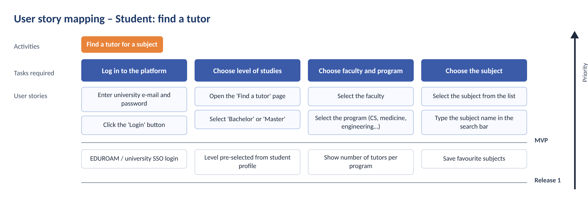
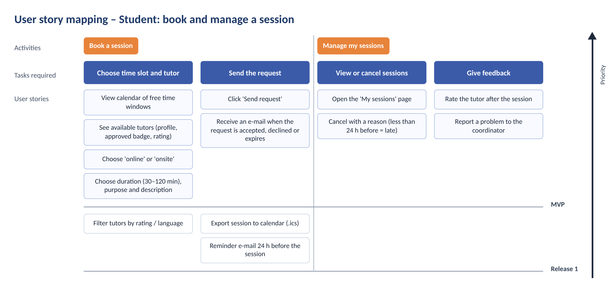
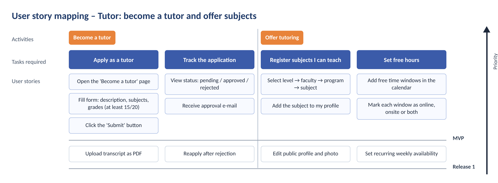
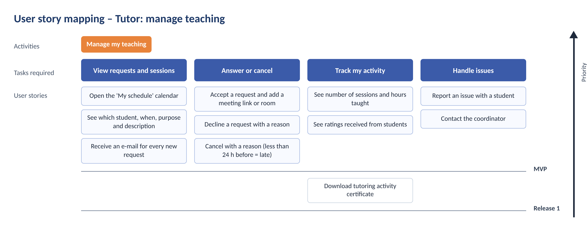
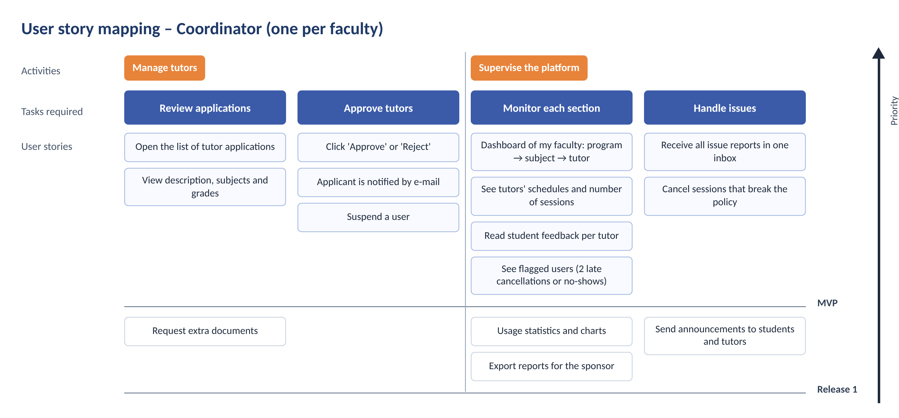

## 1.3  User story mapping (Anastasiia)

> **Current baseline (2026-11-19, Issue #14):** The PDF and embedded diagrams remain historical Deliverable 1 evidence. Revised text below is authoritative for requirements; the [decision log](requirements-decisions.md) records supersession and unresolved decisions. The [traceability matrix](requirements-traceability.md) records acceptance criteria, implementation evidence and gaps. Priority describes scope, not implementation completion.

Each map follows one user journey from left to right. Cards above the MVP line form the first release; cards between the MVP and Release 1 lines come next.

**Figure 1.** *User story map – Student: find a tutor*

**Figure 2.** *User story map – Student: book and manage a session*

**Figure 3.** *User story map – Tutor: become a tutor and offer subjects*

**Figure 4.** *User story map – Tutor: manage teaching*

**Figure 5.** *User story map – Coordinator (one per faculty)*

## 1.4  Requirements analysis

Requirements are derived from the stakeholder needs and checked against the user stories and use cases. Priorities follow the MVP and Release 1 lines of the story maps (MoSCoW).

### Functional requirements

| ID | Requirement | Priority | Source |
|---|---|---|---|
| **FR1** | University-approved Uni.lu SSO is the only login mechanism. Tutti never collects university passwords; role-appropriate access follows authentication and separate enrollment verification. | **Must** | All primary roles · UC01 |
| **FR2** | Verified students discover active approved tutors by level, faculty, program and subject, with ratings and free intervals. Cross-faculty discovery requires the same canonical subject in both participants’ programs and an active approved offering. | **Must** | S1 · UC02 |
| **FR3** | Verified students request a one-to-one session within a published free slot and configured semester, specifying start, allowed duration, mode, purpose and description. Minimum notice is 3 hours; self-booking is forbidden. | **Must** | S2 · UC03 |
| **FR4** | Introduction lasts exactly 30 minutes; all other purposes allow only 60, 90 or 120 minutes. | **Must** | S2 · UC03 |
| **FR5** | REQUESTED and ACCEPTED sessions reserve both participants across student and tutor roles. Overlapping half-open intervals are rejected; adjacent sessions are allowed. | **Must** | S2 · UC03 |
| **FR6** | For 3–25 hours of notice inclusive, expire unanswered requests at min(requested_at + 1 hour, starts_at − 2 hours); for more than 25 hours, at min(requested_at + 48 hours, starts_at − 24 hours). Reject shorter notice. Expiry releases both reservations. | **Must** | S3 · UC03, UC15 |
| **FR7** | Queue lifecycle emails to university addresses for requests, acceptance, decline, expiry, cancellation and tutor application decisions. Record delivery attempts; queueing or SMTP acceptance does not guarantee inbox receipt. | **Must** | S3 · UC15 |
| **FR8** | Either participant may cancel a REQUESTED or ACCEPTED session with a reason. Less than 24 hours before start is late; exactly 24 hours is not. Count participant incidents in the session semester. | **Must** | S4, T4 · UC04, UC16 |
| **FR9** | Only the session’s verified student may submit one integer rating 1–5 with an optional private comment for a currently COMPLETED session. Retain feedback after corrections but exclude NO_SHOW sessions from active ratings. | **Must** | S5 · UC05 |
| **FR10** | Students and tutors may report general issues, optionally linked to a session or tutor. Route linked cases to the tutor’s faculty and unlinked cases to the reporter’s home faculty. Attendance allegations use the separate adjudication workflow. | **Must** | C3 · UC06, UC13 |
| **FR11** | A verified student with no pending application may apply for exactly one subject in their program, with description and decimal grade 15.00–20.00 inclusive. Further subjects require subsequent applications after the pending decision. Only an authorized coordinator may view submitted grades. | **Must** | T1 · UC07 |
| **FR12** | Approved tutors manage semester-bounded weekly availability in an IANA time zone, date exceptions and one-off windows marked online, onsite or both. Reject overlaps and ambiguous/nonexistent local endpoints. Delete only future unbooked availability; never invalidate REQUESTED or ACCEPTED sessions. Semester dates follow the published university calendar. | **Must** | T2 · UC08 |
| **FR13** | Only the assigned tutor may accept or decline a still-pending, unexpired request. Acceptance requires the mode’s meeting link or room; decline requires a reason. | **Must** | T3 · UC09 |
| **FR14** | Tutors see upcoming sessions, completed count, teaching hours and ratings. The assigned tutor explicitly completes an accepted session once its scheduled end is reached; completion is never automatic. Counts, hours and averages derive only from currently COMPLETED sessions. | **Must** | T5 · UC09, UC10 |
| **FR15** | Only the applicant’s faculty coordinator approves or rejects the entire one-subject application, with a rejection reason. Approval creates or extends the same student’s tutor profile and approved offering; preserve qualification and decision history. | **Must** | C1 · UC11 |
| **FR16** | Coordinators monitor their faculty’s tutors, schedules, session counts, current ratings and private feedback under tutor-faculty session authority. Home-faculty flags are a separate authorized view. Use current COMPLETED sessions for activity aggregates. | **Must** | C2 · UC12 |
| **FR17** | Coordinators receive authorized general issue reports in an inbox and resolve them with notes. Separately adjudicate attendance reports: either participant may allege the other’s absence from session end through 168 elapsed hours inclusive; only the tutor-faculty coordinator confirms or rejects. Confirmation may correct COMPLETED to NO_SHOW, preserving history. | **Must** | C3 · UC06, UC13 |
| **FR18** | Count late participant cancellations and confirmed no-shows in the session’s semester. Two combined violations flag the user once to their home-faculty coordinator. An allegation alone does not count; flagging never automatically suspends. | **Must** | C4 · UC13, UC16 |
| **FR19** | Tutor-faculty coordinators may cancel policy-breaking sessions with a reason; these are not participant strikes. Only the affected user’s home-faculty coordinator suspends or reinstates with a reason. Suspension persists until reversed, restricts access and cancels future REQUESTED/ACCEPTED sessions in both roles atomically with history and notifications. | **Must** | C5, C4 · UC04, UC14 |
| **FR20** | Send a reminder 24 hours before each accepted session. | **Should** | Release 1 story map · UC15 |
| **FR21** | Coordinators export anonymous sponsor usage reports: distinct participants in completed sessions during the period, sessions held and average feedback. Suppress breakdowns with fewer than five distinct participants. | **Should** | Sponsor goal |
| **FR22** | Display a sponsor acknowledgement without advertising or personal-data disclosure. | **Should** | Sponsor goal |
| **FR23** | Integrate only the University of Luxembourg-authorized institutional identity provider. Confirm protocol and trust contract before implementing SSO; no local-password fallback, unrestricted federation or guest access. | **Must** | All primary roles · UC01 |
| **FR24** | Users may export a session to their calendar as .ics. | **Could** | Optional story-map enhancement |
| **FR25** | Payments between users are excluded; tutoring is free. | **Won't** | Free-platform decision |
| **FR26** | Alternative-time counter-proposals are excluded; tutors decline and students submit a new request. | **Won't** | T3 · UC09 scope decision |
| **FR27** | In-app notifications are excluded; lifecycle communication uses email. Viewing session status is not a notification inbox. | **Won't** | S3 · UC15 scope decision |

### Non-functional requirements

| ID | Category | Requirement |
|---|---|---|
| **NFR1** | Security | Protected functions require authenticated server-side sessions and current role, verification and suspension checks. Only explicitly public entry points (SSO initiation/callback and registration-safe catalog lookups) are exceptions. |
| **NFR2** | Security | Enforce faculty scope server-side: tutor-faculty authority for session-related cases and tutor reviews; affected user’s home faculty for flags and suspension/reinstatement. Cross-faculty tutoring does not grant general cross-faculty data access. |
| **NFR3** | Security | Use HTTPS, validate the trusted university IdP and secure application sessions. Tutti must not collect or store university passwords or offer local-password authentication fallback. Do not assume OIDC or SAML before university confirmation. |
| **NFR4** | Privacy (GDPR) | Submitted tutor grades and qualification evidence are restricted to authorized coordinator review; ordinary student/tutor views expose approved badges and aggregate ratings. Minimize private data and apply category-specific retention only after DPO review. |
| **NFR5** | Privacy (GDPR) | Sponsor reports disclose anonymous aggregates only, suppressing breakdowns with fewer than five distinct participants. Retention is category-specific and subject to DPO approval. |
| **NFR6** | Usability | A student can send a request in at most 3 steps after opening a tutor profile. |
| **NFR7** | Usability | The interface works on current desktop and mobile browsers; verify accessible core journeys. |
| **NFR8** | Performance | Search results and request confirmations appear within 2 seconds with 200 concurrent users. Representative workload, hardware and latency evidence are required; ordinary integration tests do not prove this target. |
| **NFR9** | Reliability | Record each queued email’s pending/sent/failed status, attempts and timing. SENT denotes SMTP acceptance, not inbox delivery. Delivery uses recoverable leases and retries with at-least-once semantics; duplicate actual delivery is possible. |
| **NFR10** | Availability | The platform is available 99% of the time during the semester. Measure availability in the deployment; API startup, packaging and worker polling alone do not establish attainment. |
| **NFR11** | Maintainability | Use separated HTTP, application, domain and infrastructure responsibilities; automate business-rule tests, version changes in Git and review before merging. Validate release, API and migration contracts. |
| **NFR12** | Traceability | Every session and tutor-application status transition records time, old/new status and responsible user, or explicit SYSTEM actor for automatic expiry. Commit history with the state change. Extend authorized account/disciplinary audit workflows without assuming history tables alone prove completeness. |

### Stakeholder conflicts

| Conflict | Stakeholders | Resolution |
|---|---|---|
| Students want to cancel late without consequences; tutors want enough notice. | Student vs Tutor | REQUESTED/ACCEPTED participant cancellations require a reason; less than 24 h is late. Two combined late cancellations and confirmed no-shows in the session semester create a home-faculty flag, never automatic suspension. |
| Students want to see tutors' grades to judge competence; tutors' grades are personal data. | Student vs Tutor, Data Protection Officer | Only the coordinator sees grades; students see an "approved" badge and ratings. |
| Coordinators want full access to student and tutor data; data protection requires minimal access. | Coordinator vs Data Protection Officer | Session cases follow tutor-faculty authority; account sanctions follow the affected user’s home faculty. No general cross-faculty access is granted. |
| The sponsor wants usage figures and visibility; students expect privacy. | Sponsor vs Student | Reports contain only aggregated figures; branding is an acknowledgement, no ads. |
| Tutors would like to propose other times; the team must keep the scope realistic. | Tutor vs Development team | No counter-proposals: the tutor declines with a reason and the student sends a new request. |
| Students want help with homework; lecturers require that graded work is the student's own. | Student vs Lecturers | Homework sessions explain methods only; the coordinator can cancel sessions that break this rule. |

### Assumptions

- Tutoring is free and one-to-one; tutors retain their student identity.
- Uni.lu SSO authenticates institutional identity; enrollment approval is a separate coordinator decision. Official claims do not replace manual verification without approval (D01).
- One coordinator is responsible for each faculty, with cross-faculty routing as specified in FR10 and FR16–FR19 (D03).
- Weekly schedules are semester-bounded; trusted semester maintenance follows the published calendar. The administration workflow remains planned in #50 (D04).
- Incident totals are grouped by the session semester; starting a new semester does not erase historical incidents (D07).
- Grades are declared and reviewed by an authorized coordinator. No ordinary user has university student/grade database access. The original Release 1 transcript-upload assumption remains unconfirmed; no separate scope/acceptance approval was found (U03).
- Academic-program changes must revalidate offerings without deleting qualifications or accepted sessions and without silently reactivating withdrawn offerings; the complete change workflow remains #16 (D09).
- Sponsors receive exported anonymous reports; no sponsor platform account is required. Lifecycle communications use university email, with no in-app notification inbox.
- The original 30-minute start grid is disputed by the current validation behavior and is **not resolved by this baseline**; see U01. Do not add enforcement or claim its removal was approved.

### Open questions

The [decision log](requirements-decisions.md#unresolved-decisions) is the single register of outstanding decisions and external approval gates:

- **U01 — Start grid:** confirm whether 30-minute alignment is required, including local zone/seconds semantics. Current Go and PostgreSQL booking validation do not enforce it.
- **U02 — University SSO contract:** university identity administration must confirm protocol, trusted institutional population, immutable identifier, claims and logout capabilities (#46). No protocol is presumed.
- **U03 — Official academic evidence:** confirm permitted grade/enrollment evidence and any transcript workflow. Coordinator review remains required; a Release 1 upload is not approved by this revision.
- **U04 — Retention:** DPO review must approve category-specific periods and erasure/anonymization procedures before production cleanup (#42, #60).

A flag is resolved policy, not an open automatic-sanction rule: the home-faculty coordinator decides case by case; any suspension is explicit and persists until reversed. These unresolved decisions are documented honestly; Issue #14’s literal “no unresolved contradictions” criterion cannot be asserted for U01 without a stakeholder decision.
