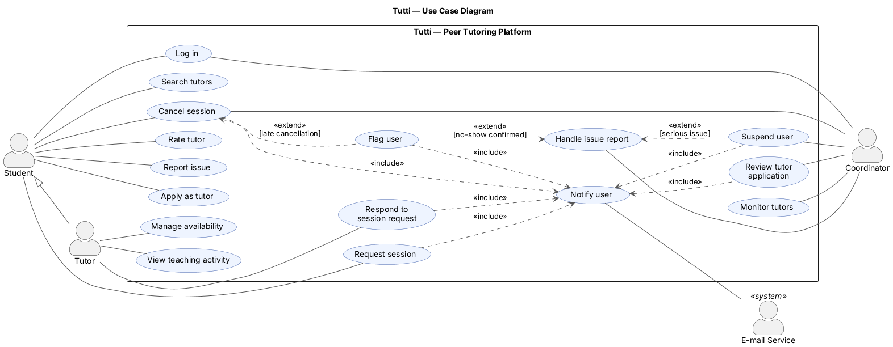

# 2. Use-Case Model (Nikita)

> **Current textual baseline:** These UC identifiers are preserved. The diagram is historical Deliverable 1 evidence; revised flows below follow the [requirements decisions](requirements-decisions.md). The [UC traceability review](requirements-traceability.md#use-case-review) records requirement links and implementation gaps. Target scenarios do not assert that a frontend or every backend operation exists.

The use-case model formalises the functional requirements: who interacts with Tutti (actors), which goals the system supports (use cases), and how the use cases relate through «include», «extend» and generalization. A Tutor is a specialization of Student, so tutors can also book sessions.

**Figure 6.** *Use-case diagram of Tutti*

## 2.1 Actors

| Actor              | Type               | Description                                                                                                                    |
|--------------------|--------------------|--------------------------------------------------------------------------------------------------------------------------------|
| **Student**        | Primary            | Any enrolled student. Searches tutors, requests and cancels sessions, rates tutors, reports issues, applies to become a tutor. |
| **Tutor**          | Primary            | A student approved for one or more subjects. Specializes Student, so a tutor can also book sessions as a student.              |
| **Coordinator**    | Primary            | One per faculty. Approves tutors, monitors tutoring, handles issues and suspends users.                                        |
| **University identity provider** | Supporting system | University-approved external institutional authentication; protocol awaits #46. |
| **E-mail Service** | Secondary (system) | External service that delivers e-mail notifications.                                                                           |

## 2.2 Use-Case Descriptions

Each description gives the actors, goal, preconditions, main success scenario, alternative flows (extensions, numbered after the step where they branch off) and postconditions.

| **UC01 Log in** | |
|---|---|
| **Actors** | Student, Tutor or Coordinator (primary); university identity provider (supporting system) |
| **Goal** | Access the platform with the right role. |
| **Preconditions** | The user has a university account. |
| **Main success scenario** | 1. User chooses Sign in with University of Luxembourg. 2. Tutti redirects to the university-approved identity provider; university credentials are entered only there. 3. Tutti validates the approved protocol response and stable identity binding, creates a secure server-side session and checks current roles, suspension and enrollment verification. 4. System opens the permitted role dashboard or verification-pending view. |
| **Extensions** | **2a. Provider unavailable or authentication fails:** deny access safely, with no local-password fallback. **3a. Invalid assertion, unapproved identity or ambiguous account binding:** deny access without elevation. **3b. Suspended account:** deny protected access. **3c. Pending/rejected student verification:** restrict access to the permitted verification workflow. SSO does not replace coordinator approval. |
| **Postconditions** | User is authenticated, or access is denied. |

| **UC02 Search tutors** | |
|---|---|
| **Actors** | Student (primary) |
| **Goal** | Find an approved tutor for a subject. |
| **Preconditions** | Student is authenticated, active and enrollment-verified. |
| **Main success scenario** | 1. Student selects level (Bachelor/Master), faculty, program and subject, or types the subject name. 2. System checks the subject belongs to the student’s program and lists active approved tutors whose programs contain that same canonical subject, including eligible cross-faculty tutors, with badges, aggregate ratings and free intervals. 3. Student opens a tutor's profile. |
| **Extensions** | **2a. No tutor for the subject:** System shows "No tutors available for this subject yet". |
| **Postconditions** | Student sees the matching tutors (or none). Tutors' grades are never shown. |

| **UC03 Request session** | |
|---|---|
| **Actors** | Student (primary), E-mail Service (secondary) |
| **Goal** | Ask a tutor for a session at a specific time. |
| **Preconditions** | Student is authenticated, active and verified and has opened an eligible tutor’s profile (UC02). Student and tutor are different people; subject eligibility and availability are rechecked in the transaction. |
| **Main success scenario** | 1. Student picks a start time inside one of the tutor's free windows. 2. Student chooses the duration (30, 60, 90 or 120 min), the mode (online/onsite, if the window allows both), the purpose (Introduction, Homework, Exam preparation, …) and writes a description. 3. System checks Introduction = 30 min, other purposes = 60/90/120 min, notice ≥ 3 hours, mode/slot/semester fit and current eligibility. 3.1 System checks both participants for cross-role overlapping reservations. 4. System creates the request with status *Requested* and reserves both participants over the half-open interval [start,end). 5. System includes **Notify user** to inform the tutor. 6. System shows "Request sent". |
| **Extensions** | **3a. Purpose and duration don't match:** System shows the allowed durations and the student corrects them. **3b. Time no longer free:** System shows an error and refreshes the free windows. **3c. Self-booking, insufficient notice or ineligible offering:** reject without creating a session. **4a. Tutor does not respond:** for notice 3–25 hours inclusive, expire at min(requested_at + 1 hour, starts_at − 2 hours); for greater notice, min(requested_at + 48 hours, starts_at − 24 hours). Expiry releases both reservations and queues notices. Responses at the deadline are rejected even before a worker poll. |
| **Postconditions** | A pending request, two reservations, history and queued notification commit atomically, or nothing is created. The original 30-minute start-grid assumption awaits U01; no grid enforcement is claimed. |

| **UC04 Cancel session** | |
|---|---|
| **Actors** | Student or Tutor (primary), Coordinator (primary), E-mail Service (secondary) |
| **Goal** | Cancel a requested or accepted session. |
| **Preconditions** | User is authenticated and is the session's student, its tutor, or the authorized tutor-faculty coordinator (policy cancellation). |
| **Main success scenario** | 1. User opens the session and selects "Cancel". 2. User enters a reason (mandatory). 3. System sets the status to *Cancelled*, records who cancelled and frees the time. 4. System includes **Notify user** to inform the other party. |
| **Extensions** | **1a. Coordinator cancels for a policy violation:** both student and tutor are notified with the reason. **3a. Less than 24 h before the session (student or tutor):** the cancellation is recorded as late and **Flag user** extends the use case. |
| **Postconditions** | Session, reason, actor, history, released reservations and required queued notices commit together. A late participant cancellation counts in the session semester; coordinator cancellations do not count as participant strikes. To meet another time, the student sends a new request. |

| **UC05 Rate tutor** | |
|---|---|
| **Actors** | Student (primary) |
| **Goal** | Give feedback on a completed session. |
| **Preconditions** | Student is active and verified, is this session’s learner, and the session is currently *Completed* and not yet rated. |
| **Main success scenario** | 1. Student opens the completed session. 2. Student gives a rating (1–5) and an optional comment. 3. System saves the feedback once; active tutor statistics derive only from currently COMPLETED sessions. |
| **Extensions** | **1a. Session already rated:** System shows the existing rating; no second rating is possible. |
| **Postconditions** | Feedback is stored. Only authorized session-participant and scoped coordinator views may see private comments; discovery shows aggregates. Later NO_SHOW correction preserves feedback but excludes it from active ratings. |

| **UC06 Report issue** | |
|---|---|
| **Actors** | Student or Tutor (primary) |
| **Goal** | Tell the coordinator about a problem. |
| **Preconditions** | User is authenticated. |
| **Main success scenario** | 1. User selects "Report a problem", optionally from a specific session. 2. User describes the issue (e.g. inappropriate behaviour; absence allegations follow UC13’s separate attendance flow). 3. System creates an issue report with status *Open* and places it in the inbox of the tutor-faculty coordinator for a linked session/tutor, or the reporter’s home-faculty coordinator for an unlinked report. 4. System confirms the report was sent. |
| **Extensions** | **2a. Description empty:** System asks the user to fill it in. |
| **Postconditions** | An open issue report exists in the coordinator's inbox. |

| **UC07 Apply as tutor** | |
|---|---|
| **Actors** | Student (primary) |
| **Goal** | Become a tutor for one subject per application; apply for further subjects after a decision. |
| **Preconditions** | Student is authenticated, active, enrollment-verified and has no pending application; chosen subject belongs to their current program. |
| **Main success scenario** | 1. Student opens "Become a tutor". 2. Student writes a description and selects exactly one subject, entering its decimal grade from 15.00 to 20.00 inclusive. 3. System validates the one subject, grade range, description, academic eligibility and absence of another pending application. 4. System saves the application with status *Pending* and sends it to the coordinator of the student's faculty. 5. System shows "Application submitted". |
| **Extensions** | **1a. Pending application already exists:** System shows its status instead of a new form. **3a. Invalid grade/subject or duplicate pending application:** reject without a partial application. Grades are excluded from ordinary student/tutor response views. |
| **Postconditions** | A pending application waits for review. |

| **UC08 Manage availability** | |
|---|---|
| **Actors** | Tutor (primary) |
| **Goal** | Publish the times when students can request sessions. |
| **Preconditions** | Tutor is authenticated and approved. |
| **Main success scenario** | 1. Tutor opens the availability calendar. 2. Tutor selects a configured semester and weekly local weekday/time with an IANA zone, online/onsite/both; manages date exceptions or one-off windows. 2.1 System generates concrete semester-bounded occurrences. Trusted semester dates follow the published university calendar; next-semester schedules require reconfirmation. 3. System checks that the window does not overlap another one. 4. System saves the change and shows the window to students. |
| **Extensions** | **2a. Window contains requested or accepted sessions:** System refuses to delete or shrink it until those sessions are cancelled (UC04). **2b. Deletion:** only future unbooked availability is removable; past session details are preserved. **3a. Overlap or ambiguous/nonexistent local endpoint:** reject atomically and identify the conflict. |
| **Postconditions** | The tutor's free windows are up to date. |

| **UC09 Respond to session request** | |
|---|---|
| **Actors** | Tutor (primary), E-mail Service (secondary) |
| **Goal** | Accept or decline a student's request. |
| **Preconditions** | Tutor is authenticated, active and assigned to the request; it is REQUESTED and not expired. Later explicit completion instead requires an owned ACCEPTED session whose scheduled end has been reached. |
| **Main success scenario** | 1. Tutor opens the request (from the e-mail link or the list of requests) and reads the student, date, duration, mode, purpose and description. 2. Tutor accepts and adds a meeting link (online) or a room (onsite). 3. System checks that the request is still *Requested* and sets the status to *Accepted*. 4. System includes **Notify user** to inform the student by e-mail. |
| **Extensions** | **2a. Tutor declines:** Tutor enters a reason; System sets the status to *Declined*, frees the time and informs the student by e-mail. **3a. Request no longer pending or deadline reached:** System rejects the response; nothing changes. **Later completion flow:** assigned tutor explicitly marks their ACCEPTED session COMPLETED once its scheduled end is reached. System records actor/time/history; reject premature, wrong-tutor or stale completion. Completion is not automatic. |
| **Postconditions** | Request is accepted with meeting details, or declined with a reason; history and notification queue are consistent. After an accepted session reaches its scheduled end, only the assigned tutor may explicitly mark it COMPLETED, with history; no automatic completion. Attendance allegations may later correct that outcome (UC13). |

| **UC10 View teaching activity** | |
|---|---|
| **Actors** | Tutor (primary) |
| **Goal** | Track own tutoring activity. |
| **Preconditions** | Tutor is authenticated. |
| **Main success scenario** | 1. Tutor opens "My activity". 2. System shows upcoming accepted sessions and derives completed count, teaching hours and ratings from sessions currently COMPLETED. A NO_SHOW correction removes the session from active aggregates without deleting feedback. |
| **Extensions** | **2a. No sessions yet:** System shows empty counters. |
| **Postconditions** | — (read only) |

| **UC11 Review tutor application** | |
|---|---|
| **Actors** | Coordinator (primary), E-mail Service (secondary) |
| **Goal** | Approve or reject a student who wants to tutor. |
| **Preconditions** | Coordinator is authenticated; a pending application from their faculty exists. |
| **Main success scenario** | 1. Coordinator opens the list of pending applications. 2. Coordinator reads the description, single subject and decimal grade (15.00–20.00). 3. Coordinator approves the application. 4. System sets it to *Approved*, creates (or extends) the student's tutor profile with the approved subject offering, preserving prior qualifications and decisions. 5. System includes **Notify user** to inform the student. |
| **Extensions** | **3a. Coordinator rejects:** Coordinator enters a reason; System sets the application to *Rejected* and notifies the student. |
| **Postconditions** | The whole one-subject application is decided once; approval extends the existing student identity/profile. Rejection reason, history and notification commit atomically. Concurrent or wrong-faculty decisions cannot alter it. |

| **UC12 Monitor tutors** | |
|---|---|
| **Actors** | Coordinator (primary) |
| **Goal** | Oversee tutoring in the faculty. |
| **Preconditions** | Coordinator is authenticated. |
| **Main success scenario** | 1. Coordinator opens the dashboard and drills down: program → subject → tutor. 2. System shows authorized tutor-faculty schedules, currently-completed counts/hours, ratings and private feedback without general cross-faculty access. 3. System separately lists home-faculty users flagged for two combined late participant cancellations or confirmed no-shows, grouped by the session semester. |
| **Extensions** | **2a. Coordinator spots a problem:** Continue with UC04 for tutor-faculty policy cancellation, or refer to the affected user’s home-faculty coordinator for UC14. Monitoring does not confer cross-faculty sanction authority. |
| **Postconditions** | — (read only) |

| **UC13 Handle issue report** | |
|---|---|
| **Actors** | Coordinator (primary); Student or Tutor (primary, separate attendance submission flow) |
| **Goal** | Resolve a reported problem. |
| **Preconditions** | General flow: authenticated coordinator has an open report in their authorized inbox. Separate attendance flow: a verified participant may submit for an ACCEPTED or COMPLETED session in the reporting window; an authenticated tutor-faculty coordinator may review an existing pending allegation. |
| **Main success scenario** | 1. Coordinator opens the issue from the inbox. 2. Coordinator reviews the description and the related session. 3. Coordinator contacts the people involved if needed and decides. 4. Coordinator closes the issue with a resolution note. |
| **Extensions** | **Separate attendance flow:** either verified session participant reports the other’s absence from scheduled end through 168 elapsed hours inclusive. Submission leaves status/count unchanged. The tutor-faculty coordinator reviews evidence and confirms or rejects with a note. Confirmation can correct ACCEPTED/COMPLETED to NO_SHOW, retaining completion/history and recording a violation once per absent user/session; rejection leaves outcome unchanged. Threshold processing uses UC16. **3b. Serious issue:** refer account sanctions to the affected user’s home-faculty coordinator (UC14); session authority does not grant sanction authority. **3c. Wrong faculty, stale/duplicate decision or expired reporting window:** reject without partial effects. |
| **Postconditions** | General issue is Resolved with a note. In the separate attendance flow, the allegation is CONFIRMED or REJECTED; any session correction, violation, flag, history and queued notices commit together. These are different records/workflows. |

| **UC14 Suspend user** | |
|---|---|
| **Actors** | Coordinator (primary) |
| **Goal** | Stop a student or tutor from using the platform. |
| **Preconditions** | Active coordinator is authenticated and assigned to the affected user’s home faculty. |
| **Main success scenario** | 1. Coordinator selects the user and "Suspend". 2. Coordinator enters a reason. 3. System suspends the account, hides the tutor profile (if any) and atomically cancels future REQUESTED/ACCEPTED sessions in both roles, recording reasons/history and queued notifications without participant strikes. 4. System includes **Notify user** to inform the suspended user and the other parties of the cancelled sessions by e-mail. |
| **Extensions** | **3a. User has no future sessions:** only account state/history changes. **3b. Wrong faculty:** deny. **3c. Reinstatement:** authorized home-faculty coordinator explicitly reverses suspension with a reason; suspension never expires automatically and does not arise automatically from flags. |
| **Postconditions** | The user cannot log in; affected sessions are cancelled. |

| **UC15 Notify user «included»** | |
|---|---|
| **Actors** | E-mail Service (secondary) |
| **Goal** | Inform a user by e-mail that something changed. All communication is by e-mail; there are no in-app notifications. |
| **Preconditions** | Triggered by UC03, UC04, UC09, UC11, UC14 or UC16, or by request expiry. |
| **Main success scenario** | 1. System records the notification (type, subject, body) with e-mail status *Pending*. 2. System sends it through the E-mail Service to the recipient's university e-mail address (`User.email`). 3. E-mail Service accepts the message; System sets the e-mail status to *Sent* and records the time. |
| **Extensions** | **3a. Temporary transport failure:** record attempt and retry with a recoverable lease/backoff. **3b. Permanent or exhausted failure:** retain FAILED status and safe failure information. Never expose private grades, evidence or credentials in notices/logs. |
| **Postconditions** | The notification records queue/delivery state; SENT establishes SMTP acceptance only, not inbox receipt. Recovery and retry are at least once and may duplicate actual delivery. |

| **UC16 Flag user «extend»** | |
|---|---|
| **Actors** | — (system behaviour) |
| **Goal** | Detect students and tutors who repeatedly cancel late or don't show up. |
| **Preconditions** | Extends UC04 (late cancellation) or UC13 (confirmed no-show). |
| **Main success scenario** | 1. System records one countable late participant cancellation or confirmed no-show and derives/counts incidents in the session’s configured semester under the affected user’s lock. 2. The count reaches 2. 3. System creates one idempotent flag for the user and session semester; home-faculty routing applies. 4. System includes **Notify user** to inform the coordinator of the user's faculty by e-mail. |
| **Extensions** | **2a. Count is below 2:** the event is only recorded. |
| **Postconditions** | The incident and threshold flag/history/queued alert are consistent. Semester history remains; the flag never suspends the user. Duplicate/concurrent processing cannot duplicate violations or miss the threshold. |
