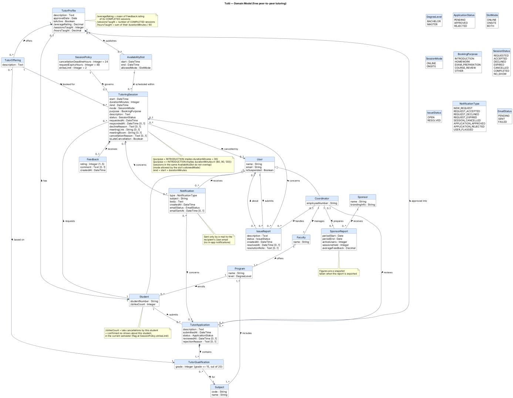

# 3 Domain Model (Stefan)

The class diagram captures the concepts Tutti must remember, their attributes and relationships. Derived attributes are marked with "/" and their formulas, like the business rules, are given in the notes.

**Figure 7.** *UML class diagram (domain model)*

## 3.1 Core concepts

`User` stores the shared account data and suspension state. `Student` specializes `User` and records the student's number and current-semester strike count. A student can submit a `TutorApplication`, which is reviewed by a `Coordinator`. An application contains one `TutorQualification` per requested `Subject`; each qualification records the declared grade. Approval creates or extends the student's `TutorProfile`, which records the approval date and whether the profile is active. A profile offers tutoring through its `TutorOffering` records.

Tutors publish `AvailabilitySlot`s with a start, end and allowed mode. A `TutoringSession` connects the student and tutor, and records the requested time, duration, mode, purpose, status and any response, meeting or cancellation details. The `SessionPolicy` defines the limits used when validating requests and cancellations. A student can leave one `Feedback` entry for a completed session.

`Faculty`, `Program` and `Subject` describe the academic structure used to organize students, tutors and tutoring. Coordinators manage a faculty. `IssueReport` records a problem raised by a user and its resolution by a coordinator. `Notification` records e-mail communication with a user. A coordinator can prepare a `SponsorReport` for a `Sponsor`; the report stores an aggregate snapshot for its reporting period.

## 3.2 Business rules and derived attributes

- An introduction session lasts exactly 30 minutes. Every other purpose requires 60, 90 or 120 minutes.
- A session must fit inside an availability slot, use a mode allowed by that slot, and not overlap another session.
- A requested session expires after 48 hours or 24 hours before its start, whichever comes first.
- A cancellation is late when it occurs less than 24 hours before the session starts.
- A tutor qualification requires a grade of at least 15 out of 20. A user's strike count is the number of late cancellations and confirmed no-shows in the current semester; the count resets each semester and a user is flagged when it reaches 2.
- Notifications are sent by e-mail to the user's university address; the model records pending, sent or failed status and the sent time. There are no in-app notifications.
- Sponsor reports contain aggregate figures and are snapshots taken when the report is exported.

The derived attributes are calculated as follows:

| Derived attribute | Formula |
|---|---|
| `TutorProfile.averageRating` | Mean of feedback ratings for the tutor's completed sessions. |
| `TutorProfile.sessionsTaught` | Number of the tutor's completed sessions. |
| `TutorProfile.hoursTaught` | Sum of completed-session durations in minutes, divided by 60. |
| `Student.strikeCount` | Late cancellations plus confirmed no-shows by the student in the current semester. |
