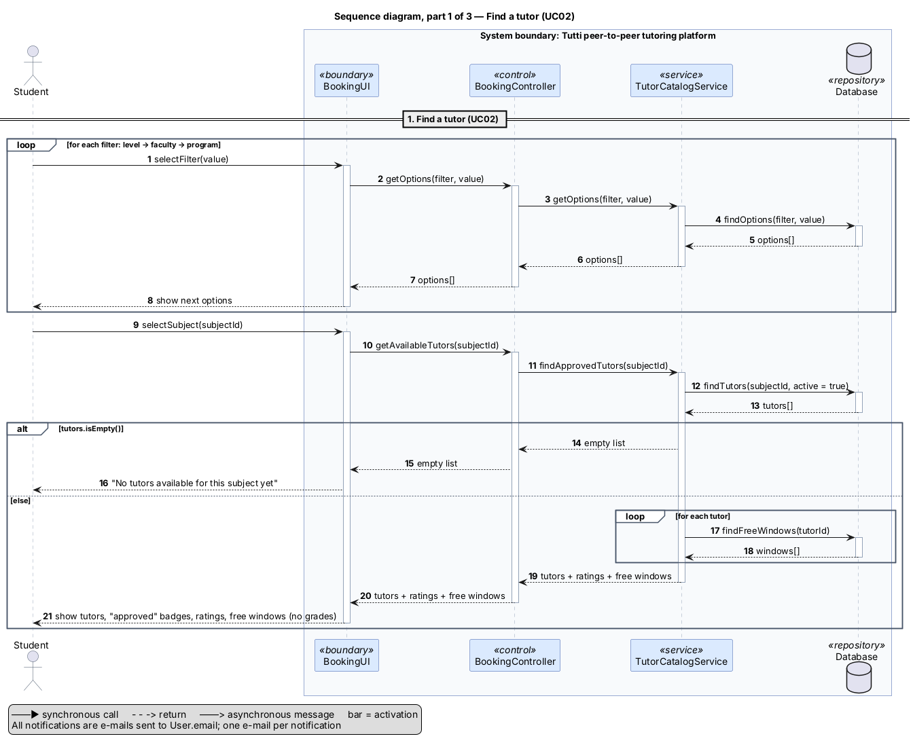
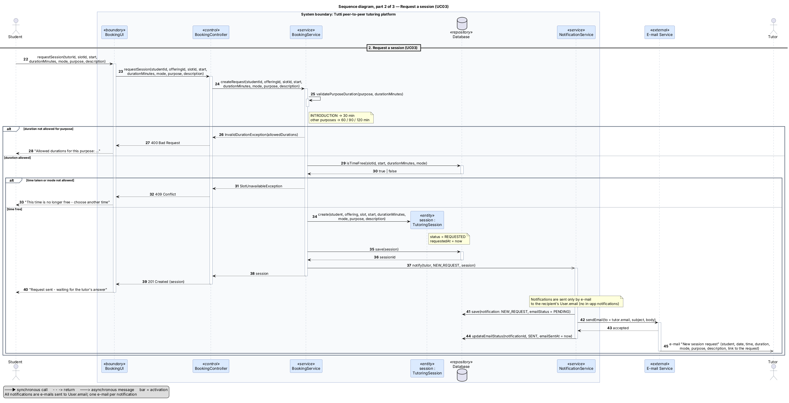
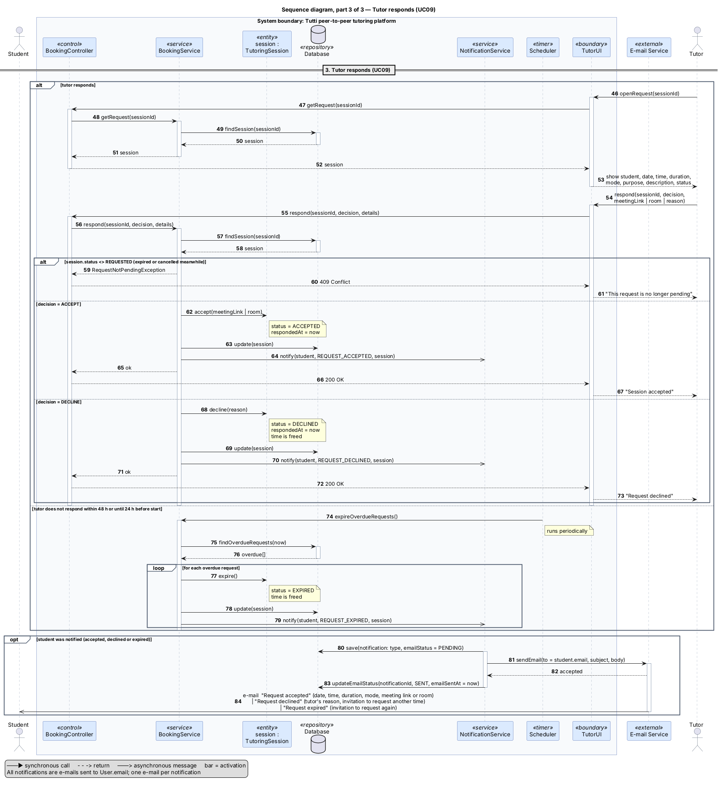

# 4. Behavioural Aspects (Yanislav)

## 4.1 Sequence Diagram

The following sequence diagrams illustrate the interaction between the actors and the Tutti peer-to-peer tutoring platform during the tutoring session booking process.

The process is divided into three parts: finding a tutor, requesting a tutoring session, and handling the tutor's response.

### 4.1.1 Find a Tutor (UC02)

This sequence diagram describes how a student searches for an available tutor by applying academic filters, selecting a subject, and viewing the list of approved tutors with their ratings and available time slots.

*Figure 8: Sequence diagram illustrating the tutor discovery process (UC02).*

### 4.1.2 Request a Session (UC03)

This sequence diagram illustrates how a student requests a tutoring session, including validation of the selected duration, availability verification, session creation, and notification of the tutor.

*Figure 9: Sequence diagram illustrating the tutoring session request process (UC03).*

### 4.1.3 Tutor Responds (UC09)

This sequence diagram describes how a tutor responds to a pending tutoring request by accepting or declining it. It also illustrates the automatic expiration of unanswered requests and the notification process that informs students of the outcome.

*Figure 10: Sequence diagram illustrating the tutor response and request expiration process (UC09).*