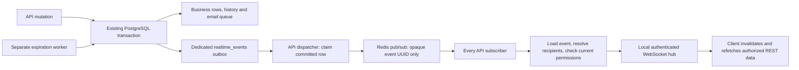

# Scheduling realtime delivery (#87)

The API now publishes committed booking and availability invalidations through
migration **17**, a dedicated PostgreSQL outbox, and Redis fanout. Existing
Scheduling/Coordination workflows, reservation constraints, audit history and the
email notification outbox are preserved. No React client is implemented here.

## End-to-end flow



The database capture functions execute inside the **original transaction**. They
perform no network IO, do not decide business transitions, and do not change any
existing reservation/history trigger. An outbox insert failure rolls back the
business transaction; disconnected clients or failed Redis publication cannot
roll it back. Normal Identity authentication still requires Redis, as before.

The common SQL enqueue capability is `enqueue_realtime_event(text,uuid)`. Using
persistence triggers here avoids missing the separately wired attendance,
policy/suspension cancellation and worker paths, without adding network publisher
calls to domain services or importing another module's repositories into them.
Routing is deliberately outside these capture triggers.

## Producer coverage

| Persistence boundary | Existing application paths captured | Events |
| --- | --- | --- |
| `tutoring_sessions` INSERT/status UPDATE | Request, accept, decline, participant cancellation, expiration, completion, confirmed no-show correction, policy cancellation and suspension cancellation | `booking.changed` for the session; `availability.changed` for its tutor |
| `session_participant_blocks` INSERT/DELETE | Creation and release of reservations by existing triggers | `availability.changed` for each participant who also has a tutor profile |
| `availability_rules` INSERT/UPDATE/DELETE | Recurrence creation, edits and removal, including empty rules | `availability.changed` for the tutor |
| `availability_slots` INSERT/UPDATE/DELETE | One-off windows, generated slots, replacements, deletion and retained-slot rule-reference changes | `availability.changed` for the tutor |
| `availability_exceptions` INSERT/UPDATE/DELETE | Skipped occurrences and restoration; parent deletion is covered by the rule trigger | `availability.changed` for the tutor |

A learner may also teach: booking as a student removes time from that learner's
own tutor free-time projection, so both participants' relevant tutor windows are
invalidated. Public watchers receive **only tutor identifiers**, never session IDs.
Completion/no-show invalidates booking views here; standalone tutor activity,
feedback, application and account publishers remain #88.

Capture coalesces on `(producer_xid,event_type,entity_id)` using PostgreSQL's full
`xid8` transaction identity. Replacing fifty slots in one transaction yields one
availability event per affected tutor. The first UUID and occurrence timestamp
are retained. Separate committed transactions produce separate events. A rolled
back transaction or savepoint leaves no deliverable row. Existing records are
not backfilled on migration. Session metadata updates that do not change status
are not separate producers; all current booking lifecycle operations change status.

## Durable outbox, claims and retries

`realtime_events` contains a stable UUID, transaction ID, type, minimal entity UUID,
occurrence time, retry time, attempt count, claim token, lease, dispatch timestamp
and a fixed operational failure category. The event identity/payload is immutable.
It contains no grades, messages, emails, reasons, meeting details or saved recipient
entitlements. Only the two scheduling event types are produced by migration 17;
the version-1 WebSocket envelope stays unchanged.

Every API process runs a dispatcher immediately, then polls once per second.
A batch runs for at most twenty seconds and handles at most twenty rows. Rows are
claimed one at a time with an atomic `FOR UPDATE SKIP LOCKED` / UPDATE statement,
a random ownership token and a thirty-second lease. No database lock is held over
Redis IO. Each database/Redis operation has a three-second context deadline.
Acknowledgment and retry updates require the current unexpired ownership token.
Expired claims can be recovered; stale acknowledgments cannot modify a newer claim.

Publishing to Redis succeeds only when Redis accepts the event UUID and reports
at least one subscriber. Failure schedules exponential retry from one second up
to five minutes, without a finite retry cutoff. Crashed dispatchers leave leases
that expire. A publish that succeeded but lost its database acknowledgment can
publish again with the **same event ID**. `dispatched_at` means accepted transient
fanout, **not** receipt by every API, delivery to a browser or durable replay.

Each API establishes its own Redis subscription before starting dispatch/HTTP
serving. Multiple dispatchers share claims; all subscribers independently receive
the chosen dispatcher's publications. Each subscriber reloads the corresponding
committed event from PostgreSQL, validates it, resolves current candidates, and
queues through the existing `application.Publisher` interface. The Redis channel
`tutti:realtime:v1` carries only the 36-character event UUID. Redis is never the
durable event store. A bounded 4096-ID cache per subscriber suppresses repeat local
queueing; clients must also deduplicate IDs and tolerate reordering.

On subscriber IO failure, re-subscription, or failed event lookup/routing, the API
closes its current sockets using `Hub.Resync`, preserving the hub for new
connections. Clients must reconnect, refetch visible HTTP data and renew watches.
There is no offline event replay or per-browser acknowledgment. An API that is
stopped while another accepts the fanout can miss events; reconnect refetch is
part of correctness, not an optional optimization. Already authorized writes can
race access changes; the existing hub's fresh session/policy checks and minimal
payloads remain essential.

The separate worker still connects only to PostgreSQL and SMTP. Its normal
Scheduling expiration operation writes the same tables and transactionally creates
outbox rows. It does **not** need a Redis client or realtime polling loop. If every
API is offline, worker events remain pending until an API starts. Multi-API fanout
does not require a worker to know which process owns a socket.

## Recipient authority

Scheduling publishes a narrow `RealtimeQueries.BookingAudience` read port through
its existing PostgreSQL booking repository. Realtime routing consumes that port;
only bootstrap connects concrete adapters. No broad session DTO is copied into
an event or Redis message.

- Booking candidates are the session's student, tutor and the current coordinator
  assigned to its **stored session faculty**. The hub re-authenticates each socket,
  then routing rereads the audience. Participants must still be verified students;
  the coordinator must still match the assignment and faculty. A learner's unrelated
  home-faculty coordinator is not a session-event recipient merely because they
  can administer the learner's account.
- Availability candidates are the owning tutor and registered viewers. The owner
  must still have current tutor privileges. Every viewer needs a live watch,
  verified student access, and the existing Tutoring `CanViewAvailability` check
  again immediately before delivery. That check deliberately matches the existing
  HTTP view; watching availability is not proof of subject eligibility to book.
- Client-supplied user/faculty IDs never select recipients. Resource IDs select a
  view to authorize, not a room that grants permission. Negative authorization
  drops the event; unavailable policy dependencies fail closed through the hub.

## Availability watch API for #90

`POST /api/v1/realtime/availability-watches` uses existing cookie authentication
and exact same-origin validation. Send JSON:

```json
{"tutor_id":"00000000-0000-0000-0000-000000000412"}
```

On success it returns HTTP 200 with `{"expires_at":"...UTC timestamp..."}`.
The body is limited to 1024 bytes. Unknown fields, trailing JSON and query strings
are refused. The user comes exclusively from the trusted principal. Pending or
unverified students, invisible tutors and exhausted watch limits are refused.
Existing authentication failures keep existing Identity HTTP semantics; this
handler uses 400 for malformed requests, 403 for refused watches and 503 for
unavailable registration/visibility infrastructure.

Watches are server-authorized, ten-minute **Redis leases** shared across API
instances, with at most 32 tutors per user and 16384 live user/tutor pairs overall.
Atomic Lua scripts use Redis's clock, trim expired sorted-set entries and bound
renewals. Keys use the `tutti:{realtime}:watches:` namespace; the global cap and
reverse indexes share one Redis hash slot. A watch made through API A applies to
that user's sockets on API B. Leases are ephemeral view interest, not durable
business data. No browser sends subscription JSON on `/ws`; such messages still
close the socket as required by the foundation contract.

#90 must register watches for active tutor profiles/free-slot/discovery results,
renew them before expiry (for example at five minutes while visible), and register
again after every reconnect/auth change. One user-wide lease covers multiple tabs;
there is no global unsubscribe that lets one tab remove another tab's interest.
Closing a view stops renewal; the lease expires. Re-register then refetch to cover
a mutation racing initial registration. Use bounded backoff for transient failures
and stop unauthenticated reconnect attempts. The current React code is unchanged,
so automatic live refresh is **not yet a browser-visible feature**.

## Deployment, rollback and operations

Apply migration 17 before the updated API. The API fails safely at startup when
the outbox schema or initial subscription is unavailable. No new environment
variables or dependencies are needed: dispatch and watch traffic use the existing
`DATABASE_URL`, `REDIS_URL` and `PUBLIC_ORIGIN`. REST timeouts and the `/ws` bypass
remain unchanged. Worker SMTP setup remains independent of realtime delivery.

Runtime database writers must be permitted to INSERT the outbox and read the
capture functions' referenced scheduling/tutor tables. API dispatchers also need
SELECT/UPDATE on the outbox. Do not expose PostgreSQL or the Redis pub/sub/watch
namespace to browser clients. Production Redis ACLs must cover the required
pub/sub and sorted-set/Lua operations, alongside existing session commands.

No automatic retention deletion runs in this issue. Monitor pending count, oldest
pending age, attempts and expired leases; the partial pending index supports claim
selection. #89 must establish retention, metrics, operational alerts, outage/load
limits and throughput sizing. Event IDs are not a business audit substitute.
The email notification queue and its SMTP at-least-once contract are untouched.

The down migration refuses to discard pending realtime rows. Stop API/worker
writers, drain pending publication and review/back up retained outbox data before
rolling back. It removes only realtime tables/functions/triggers; all scheduling,
reservation, history and email data remain. Do not delete pending rows in a shared
or production database to bypass the guard. Tests remove only their own synthetic
outbox data in disposable databases to exercise rollback/reapply safely.

## Verification and handoff

Tests use disposable PostgreSQL/Redis, actual sessions, two native WebSocket hubs,
a real production-bootstrap API, and a separate executable running the same
`Expiration.RunBatch` operation as the worker with a deterministic trusted clock.
They cover rollback/no uncommitted visibility, coalescing, concurrent claims,
stale-token fencing, failed publication/retry, duplicate IDs, concurrent booking,
expiry, completion/no-show, rule/exception/slot changes, administrative cancellation,
watch bounds/expiry/privacy, cross-API delivery, resubscription and reconnect refetch.
No mock backend or fabricated frontend refresh is used.

```sh
(cd backend && go test -race ./... && go vet ./... && go build ./...)
bash backend/tests/integration/test_identity.sh -race
python3 backend/tests/integration/test_schema.py
```

Frontend #90 still owns the singleton socket client, ID deduplication, watch
registration/renewal, reconnect/refetch behavior and integration with the existing
HTTP cache/forms. Browser journeys remain #90–#94. Reliability #89 still owns
production proxy/outage/load tests, operational metrics/retention/alerts, Redis ACL
and buffer sizing, publisher throughput and large deployment hardening. The
implementation already supports cross-process fanout; it does not claim durable
browser delivery, global ordering or persistent replay.

Changed implementation: migration 17; `internal/realtime/application` dispatch and
routing ports/services; PostgreSQL outbox and Redis fanout/watch adapters;
`internal/realtime/interfaces/http/watches.go`; Scheduling's application routing
read port and PostgreSQL implementation; `platform/realtime.Hub.Resync`; bootstrap
runtime wiring; the realtime scheduling/bootstrap tests, existing cancellation
assertions and migration validation. No production business workflow, frontend
component, email adapter, worker configuration or dependency version is changed.
