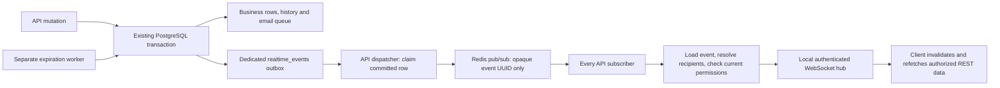

# Backend realtime delivery (#87–#88)

The API publishes all six v1 invalidation categories through migrations **17–18**,
the existing PostgreSQL outbox, and Redis fanout. Existing
Scheduling/Coordination workflows, reservation constraints, audit history and the
email notification outbox are preserved. No React client is implemented here.

## End-to-end flow



The database capture functions execute inside the **original transaction**. They
perform no network IO, do not decide business transitions, and do not change any
existing reservation/history trigger. An outbox insert failure rolls back the
business transaction; disconnected clients or failed Redis publication cannot
roll it back. Normal Identity authentication still requires Redis, as before.

The common SQL enqueue capability is `enqueue_realtime_event(text,uuid)`. Using
persistence triggers here avoids missing the separately wired attendance,
policy/suspension cancellation and worker paths, without adding network publisher
calls to domain services or importing another module's repositories into them.
Routing is deliberately outside these capture triggers.

## Producer coverage

| Persistence boundary | Existing application paths captured | Events |
| --- | --- | --- |
| `tutoring_sessions` INSERT/status UPDATE | Request, accept, decline, participant cancellation, expiration, completion, confirmed no-show correction, policy cancellation and suspension cancellation | `booking.changed` for the session; `availability.changed` for its tutor |
| `session_participant_blocks` INSERT/DELETE | Creation and release of reservations by existing triggers | `availability.changed` for each participant who also has a tutor profile |
| `availability_rules` INSERT/UPDATE/DELETE | Recurrence creation, edits and removal, including empty rules | `availability.changed` for the tutor |
| `availability_slots` INSERT/UPDATE/DELETE | One-off windows, generated slots, replacements, deletion and retained-slot rule-reference changes | `availability.changed` for the tutor |
| `availability_exceptions` INSERT/UPDATE/DELETE | Skipped occurrences and restoration; parent deletion is covered by the rule trigger | `availability.changed` for the tutor |

A learner may also teach: booking as a student removes time from that learner's
own tutor free-time projection, so both participants' relevant tutor windows are
invalidated. Public watchers receive **only tutor identifiers**, never session IDs.
Completion/no-show also invalidates activity when the completed-session aggregate
changes. Additional domain capture and recipient policies are listed below.

Capture coalesces on `(producer_xid,event_type,resource_kind,entity_id)` using PostgreSQL's full
`xid8` transaction identity. Replacing fifty slots in one transaction yields one
availability event per affected tutor. The first UUID and occurrence timestamp
are retained. Separate committed transactions produce separate events. A rolled
back transaction or savepoint leaves no deliverable row. Existing records are
not backfilled on migration. Session metadata updates that do not change status
are not separate producers; all current booking lifecycle operations change status.

## Domain producers and recipients (#88)

Migration 18's additional producers and current read policies are:

| Existing mutation | Event / public `entityId` | Authorized recipients |
| --- | --- | --- |
| Tutor application submission, approval, rejection | `tutor_application.changed` / application UUID | Active student owner, including restricted access to own history; current coordinator of the application's **stored faculty** |
| Offering activation/deactivation, replacement qualification, eligibility reconciliation | `tutor_application.changed` / associated application UUID (both evidence pointers if replaced) | Same application read policy; no public application-ID broadcast |
| General issue submission/resolution | `coordination.changed` / issue UUID | Current coordinator of the issue's **stored faculty**; the HTTP API has no reporter case-read endpoint |
| Attendance report submission/confirmation/rejection | `coordination.changed` / report UUID | Current coordinator of the session's **stored tutor faculty** |
| Confirmed no-show or late-cancellation violation | `coordination.changed` / violation UUID | Current coordinator of the violation's **stored home faculty**, matching audit access |
| Semester threshold flag creation | `coordination.changed` / flag UUID | Current coordinator of the flag's **stored faculty**; flagging still never suspends automatically |
| Coordinator policy cancellation | `coordination.changed` / session status-history UUID | Current coordinator of the session's stored faculty; #87 capture remains unchanged |
| Suspension/reinstatement decision | `coordination.changed` / suspension decision UUID | Current home-faculty coordinator, while that faculty also matches the decision's stored audit authority; a later move does not transfer private historical IDs |
| Verification submission/rejection/resubmission/approval | `coordination.changed` / verification UUID | Current coordinator of the verification's **stored faculty** |
| Session completion/correction out of `COMPLETED`; feedback insertion | `activity.changed` / tutor UUID | Tutor with current tutor privileges; current **home-faculty** monitoring coordinator; verified viewers with a live tutor watch and current public-profile visibility |
| Verification, suspension/reinstatement, closure, student membership/program, coordinator assignment, tutor profile role changes | `account.access_changed` / **omitted** | Affected account only, if the socket remains eligible |

The enqueue overload `enqueue_realtime_event(text,uuid,text)` stores a private
coordinator resource kind. Including that kind in the coalescing key prevents
equal UUIDs in different case tables from selecting the wrong authority. Tutoring,
Coordination and Identity expose narrow application read ports wired by bootstrap.
Candidates and resource authorization are reread during delivery; the hub reloads
Identity access. Browser-provided IDs never grant authority.

An approval's application update and offering insert coalesce into one application
event. Multiple account changes in a transaction also coalesce. Completed-session
no-show corrections legitimately produce existing booking/availability events,
case/violation/possible flag events, and activity invalidation. Activity remains
derived from authoritative sessions/feedback; there are no new counters. No grades,
private comments, feedback authors, evidence, reasons, meeting links, emails or
tokens enter events. Private account targets are absent from `Event` and `Claim`.

The existing gateway closes sockets when the checked access projection changes,
including role upgrades. Final access-event delivery is not guaranteed and never
bypasses suspension checks. Quiet sockets retain the **15-second** revalidation
interval and **3-second** authentication-check budget: nominally up to about
18 seconds after a just-missed check. Per-event checks also apply; already
authorized/in-flight bytes cannot be recalled. This is not instantaneous revocation.

### Refetch contract and deferred work (#90/#93)

| Event | Existing HTTP views to refetch when visible and authorized |
| --- | --- |
| `tutor_application.changed` | `/api/v1/tutor-applications/me`, `/tutor-applications/{id}`, `/coordinator/tutor-applications`, review detail, own tutor profile and coordinator monitoring |
| `coordination.changed` | Relevant `/api/v1/coordinator/issues`, `/attendance-reports`, `/verifications`, flagged-user, audit-history and monitoring views |
| `activity.changed` | `/api/v1/tutors/me/activity`, `/tutors/{id}`, visible discovery/rating results, `/coordinator/tutors/{id}/feedback` and monitoring |
| `account.access_changed` | `/api/v1/auth/me`, then protected queries and authorized watches |

Coordinator `entityId` denotes a case/audit record, not a user or faculty. Its
private kind is absent on wire: refresh visible authorized queues rather than
guessing a detail endpoint from the UUID. Public rating viewers reuse the existing
availability-watch lease; no new subscription message is introduced. Every
successful connection still requires HTTP refetch, even when no event arrives.
Shared React handling is #90, coordinator integration #93, browser E2E #94.
Backend/frontend human contract approval remains pending.

Verification resubmission can change a restricted student's program. The existing
transaction-bound Tutoring eligibility adapter captures deactivations, but a general
verified-student program-change endpoint (#74) and new role/SSO administration are
outside #88. Capture supports trusted assignment writes without introducing such
workflows. The actual worker performs expiration and SMTP delivery; neither changes
these four categories. Existing #87 expiration events cover session queues, and its
separate-process regression remains. No second worker dispatcher is added.

### Dispatch and recovery

`realtime_events` contains a stable UUID, transaction ID, type, minimal entity UUID,
occurrence time, retry time, attempt count, claim token, lease, dispatch timestamp
and a fixed operational failure category. The event identity/payload is immutable.
It contains no grades, messages, emails, reasons, meeting details or saved recipient
entitlements. Migration 17 captures the two scheduling categories; migration 18 captures the
remaining four. The version-1 WebSocket envelope stays unchanged. Private
`resource_kind` disambiguates coordinator record types; account `entity_id` is
a private target, removed from both public event lookups and dispatcher claims.

Every API process runs a dispatcher immediately, then polls once per second.
A batch runs for at most twenty seconds and handles at most twenty rows. Rows are
claimed one at a time with an atomic `FOR UPDATE SKIP LOCKED` / UPDATE statement,
a random ownership token and a thirty-second lease. No database lock is held over
Redis IO. Each database/Redis operation has a three-second context deadline.
Acknowledgment and retry updates require the current unexpired ownership token.
Expired claims can be recovered; stale acknowledgments cannot modify a newer claim.

Publishing to Redis succeeds only when Redis accepts the event UUID and reports
at least one subscriber. Failure schedules exponential retry from one second up
to five minutes, without a finite retry cutoff. Crashed dispatchers leave leases
that expire. A publish that succeeded but lost its database acknowledgment can
publish again with the **same event ID**. `dispatched_at` means accepted transient
fanout, **not** receipt by every API, delivery to a browser or durable replay.

Each API establishes its own Redis subscription before starting dispatch/HTTP
serving. Multiple dispatchers share claims; all subscribers independently receive
the chosen dispatcher's publications. Each subscriber reloads the corresponding
committed event from PostgreSQL, validates it, resolves current candidates, and
queues through the existing `application.Publisher` interface. The Redis channel
`tutti:realtime:v1` carries only the 36-character event UUID. Redis is never the
durable event store. A bounded 4096-ID cache per subscriber suppresses repeat local
queueing; clients must also deduplicate IDs and tolerate reordering.

On subscriber IO failure, re-subscription, or failed event lookup/routing, the API
closes its current sockets using `Hub.Resync`, preserving the hub for new
connections. Clients must reconnect, refetch visible HTTP data and renew watches.
There is no offline event replay or per-browser acknowledgment. An API that is
stopped while another accepts the fanout can miss events; reconnect refetch is
part of correctness, not an optional optimization. Already authorized writes can
race access changes; the existing hub's fresh session/policy checks and minimal
payloads remain essential.

The separate worker still connects only to PostgreSQL and SMTP. Its normal
Scheduling expiration operation writes the same tables and transactionally creates
outbox rows. It does **not** need a Redis client or realtime polling loop. If every
API is offline, worker events remain pending until an API starts. Multi-API fanout
does not require a worker to know which process owns a socket.

## Recipient authority

Scheduling publishes a narrow `RealtimeQueries.BookingAudience` read port through
its existing PostgreSQL booking repository. Realtime routing consumes that port;
only bootstrap connects concrete adapters. No broad session DTO is copied into
an event or Redis message.

- Booking candidates are the session's student, tutor and the current coordinator
  assigned to its **stored session faculty**. The hub re-authenticates each socket,
  then routing rereads the audience. Participants must still be verified students;
  the coordinator must still match the assignment and faculty. A learner's unrelated
  home-faculty coordinator is not a session-event recipient merely because they
  can administer the learner's account.
- Availability candidates are the owning tutor and registered viewers. The owner
  must still have current tutor privileges. Every viewer needs a live watch,
  verified student access, and the existing Tutoring `CanViewAvailability` check
  again immediately before delivery. That check deliberately matches the existing
  HTTP view; watching availability is not proof of subject eligibility to book.
- Client-supplied user/faculty IDs never select recipients. Resource IDs select a
  view to authorize, not a room that grants permission. Negative authorization
  drops the event; unavailable policy dependencies fail closed through the hub.

## Availability watch API for #90

`POST /api/v1/realtime/availability-watches` uses existing cookie authentication
and exact same-origin validation. Send JSON:

```json
{"tutor_id":"00000000-0000-0000-0000-000000000412"}
```

On success it returns HTTP 200 with `{"expires_at":"...UTC timestamp..."}`.
The body is limited to 1024 bytes. Unknown fields, trailing JSON and query strings
are refused. The user comes exclusively from the trusted principal. Pending or
unverified students, invisible tutors and exhausted watch limits are refused.
Existing authentication failures keep existing Identity HTTP semantics; this
handler uses 400 for malformed requests, 403 for refused watches and 503 for
unavailable registration/visibility infrastructure.

Watches are server-authorized, ten-minute **Redis leases** shared across API
instances, with at most 32 tutors per user and 16384 live user/tutor pairs overall.
Atomic Lua scripts use Redis's clock, trim expired sorted-set entries and bound
renewals. Keys use the `tutti:{realtime}:watches:` namespace; the global cap and
reverse indexes share one Redis hash slot. A watch made through API A applies to
that user's sockets on API B. Leases are ephemeral view interest, not durable
business data. No browser sends subscription JSON on `/ws`; such messages still
close the socket as required by the foundation contract.

#90 must register watches for active tutor profiles/free-slot/discovery results,
renew them before expiry (for example at five minutes while visible), and register
again after every reconnect/auth change. One user-wide lease covers multiple tabs;
there is no global unsubscribe that lets one tab remove another tab's interest.
Closing a view stops renewal; the lease expires. Re-register then refetch to cover
a mutation racing initial registration. Use bounded backoff for transient failures
and stop unauthenticated reconnect attempts. The current React code is unchanged,
so automatic live refresh is **not yet a browser-visible feature**.

## Deployment, rollback and operations

Apply migrations through **18** before the updated API. The API fails safely at startup when
the outbox schema or initial subscription is unavailable. No new environment
variables or dependencies are needed: dispatch and watch traffic use the existing
`DATABASE_URL`, `REDIS_URL` and `PUBLIC_ORIGIN`. REST timeouts and the `/ws` bypass
remain unchanged. Worker SMTP setup remains independent of realtime delivery.

Use a coordinated API rollout: stop migration-17-only API instances before
enabling the new producers and start the updated instances after migration 18.
Old routers cannot process the four new categories and would force socket resync.
Likewise downgrade the API only after stopping writers, draining and rolling back
18. This release does not support mixed old/new routing versions.

Runtime database writers must be permitted to INSERT the outbox and read the
capture functions' referenced domain tables. API dispatchers also need
SELECT/UPDATE on the outbox. Do not expose PostgreSQL or the Redis pub/sub/watch
namespace to browser clients. Redis pub/sub is global across Redis database numbers: use a Redis instance dedicated to this Tutti deployment until #89 adds explicit deployment channel namespacing. Separate database indexes alone do not isolate pub/sub channels. Production Redis ACLs must cover the required
pub/sub and sorted-set/Lua operations, alongside existing session commands.

No automatic retention deletion runs in this issue. Monitor pending count, oldest
pending age, attempts and expired leases; the partial pending index supports claim
selection. #89 must establish retention, metrics, operational alerts, outage/load
limits and throughput sizing. Event IDs are not a business audit substitute.
The email notification queue and its SMTP at-least-once contract are untouched.

Migration 18 down refuses pending domain events, removes dispatched domain
invalidations and restores migration 17 capture/coalescing; it retains scheduling
events and all business/audit/email records. Migration 17 down refuses any
pending realtime row before removing the outbox. Stop API/worker
writers, drain pending publication and review/back up retained outbox data before
rolling back. It removes only realtime tables/functions/triggers; all scheduling,
reservation, history and email data remain. Do not delete pending rows in a shared
or production database to bypass the guard. Tests remove only their own synthetic
outbox data in disposable databases to exercise rollback/reapply safely.

## Verification and handoff

Tests use disposable PostgreSQL/Redis, actual sessions, two native WebSocket hubs,
a real production-bootstrap API, and a separate executable running the same
`Expiration.RunBatch` operation as the worker with a deterministic trusted clock.
They cover rollback/no uncommitted visibility, coalescing, concurrent claims,
stale-token fencing, failed publication/retry, duplicate IDs, concurrent booking,
expiry, completion/no-show, rule/exception/slot changes, administrative cancellation,
watch bounds/expiry/privacy, cross-API delivery, resubscription and reconnect refetch.
No mock backend or fabricated frontend refresh is used.

`TestRealtimeMutationPublication` adds exact outbox-to-socket assertions for each
rule create/update/delete, one-off create/delete, generated-slot deletion (which
creates an exception), exception restoration, and reservation creation/release.
Every operation checks event type, affected tutor/session, stable UUID, timestamp,
transaction identity and exact recipient sets across two API hubs. Multiple slot
or reservation trigger writes must coalesce to one availability event per tutor
per transaction, including when a student is also a tutor. Test-only FIFO markers
are sent after both real fanout receivers finish queueing, so missing, duplicate
or unauthorized socket events fail without negative sleep windows.

Rejected overlapping rule replacements, reserved-slot/rule changes and conflicting
bookings leave no deliverable events. A separate connection cannot dispatch an
uncommitted capture, and rollback removes it. A failed Redis publication preserves
the committed availability row, persists retry state, and subsequently delivers
the same event UUID and payload. The existing scheduling suite continues to test
concurrent claims, stale-token fencing and separate-process expiration delivery;
the migration runner verifies capture/coalescing, guarded rollback and reapply.

Policy-cancellation sockets are checked for both participants and the current
session-faculty coordinator. Suspension cancels both requested and accepted test
sessions in one transaction: the tutor and session-faculty coordinator receive
both booking invalidations, while the public watcher receives one coalesced tutor
invalidation. The suspended participant is disconnected; unrelated users and the
learner's home-faculty coordinator receive no private booking identifiers, even
when that coordinator initiated suspension. Tests also check released reservations,
preserved cancellation reasons/history and queued participant/account emails.

```sh
(cd backend && go test -race ./... && go vet ./... && go build ./...)
bash backend/tests/integration/test_identity.sh -race
python3 backend/tests/integration/test_schema.py
```

The remaining frontend handoff is explicit:

- **#90:** Implement the shared authenticated `/ws` client using the existing auth
  context and HTTP client. Validate the v1 envelope, deduplicate by event ID,
  tolerate reordering, reconnect with bounded backoff, and refetch visible HTTP
  data after every successful connection. Provide shared availability-watch
  registration/renewal and repeat registration then refetch after reconnect.
- **#91:** Consume `booking.changed` (`entityId` is a session UUID) in the existing
  booking feature. Refetch affected `sessionsApi.mine` and `sessionsApi.tutorQueue`
  results, session detail when displayed, and available actions. Event payloads
  carry no status or meeting details; obtain them through authorized REST reads.
- **#92:** Register authorized watches for visible tutors through
  `POST /api/v1/realtime/availability-watches`, renew the ten-minute leases while
  needed, and consume `availability.changed` (`entityId` is a **tutor** UUID).
  Refresh affected `tutorsApi.availability`, visible discovery/profile results,
  and the owner's `availabilityApi` windows/rules/skipped-date views. Scope by
  tutor and existing view filters; the event contains no course or slot ID.

These are requirements for the existing React features, not implemented browser
updates. Browser journeys and duplicate-free UI effects still need #90–#94
integration/E2E evidence before the full user-facing #87 criteria can be closed.
Reliability #89 still owns
production proxy/outage/load tests, operational metrics/retention/alerts, Redis ACL
and buffer sizing, publisher throughput and large deployment hardening. The
implementation already supports cross-process fanout; it does not claim durable
browser delivery, global ordering or persistent replay.

Changed implementation: migration 17; `internal/realtime/application` dispatch and
routing ports/services; PostgreSQL outbox and Redis fanout/watch adapters;
`internal/realtime/interfaces/http/watches.go`; Scheduling's application routing
read port and PostgreSQL implementation; `platform/realtime.Hub.Resync`; bootstrap
runtime wiring; the realtime scheduling/bootstrap tests, existing cancellation
assertions and migration validation. No production business workflow, frontend
component, email adapter, worker configuration or dependency version is changed.

## Windows PowerShell verification (#88)

From the repository root, these commands use the existing Dockerfile test target.
They do not load/overwrite `.env`, start SMTP, change Compose services or remove
existing volumes. Rebuild this image after Go or migration/test changes.

```powershell
Push-Location backend
try {
    go test -race ./...
    if ($LASTEXITCODE -ne 0) { throw 'Go race tests failed' }
    go vet ./...
    if ($LASTEXITCODE -ne 0) { throw 'Go vet failed' }
    go build ./...
    if ($LASTEXITCODE -ne 0) { throw 'Go build failed' }
} finally { Pop-Location }

docker build --target test -t tutti-realtime88-tests ./backend
if ($LASTEXITCODE -ne 0) { throw 'Test image build failed' }
$testNetwork = 'tutti-realtime88-' + [guid]::NewGuid().ToString('N')
docker network create $testNetwork
if ($LASTEXITCODE -ne 0) { throw 'Test network creation failed' }
try {
    docker run --rm --network $testNetwork --mount type=bind,source=/var/run/docker.sock,target=/var/run/docker.sock -e "TUTTI_TEST_DOCKER_NETWORK=$testNetwork" tutti-realtime88-tests bash tests/integration/test_identity.sh -race -timeout 180s
    if ($LASTEXITCODE -ne 0) { throw 'Integration tests failed' }
    docker run --rm --network $testNetwork --mount type=bind,source=/var/run/docker.sock,target=/var/run/docker.sock -e "TUTTI_TEST_DOCKER_NETWORK=$testNetwork" tutti-realtime88-tests python3 tests/integration/test_schema.py
    if ($LASTEXITCODE -ne 0) { throw 'Schema tests failed' }
} finally { docker network rm $testNetwork }
git diff --check
git status --short --branch
git diff --stat
```

For focused delivery checks, append `-run '^TestRealtime'` to the integration
runner invocation. The runner creates and cleans up disposable PostgreSQL 17 and
Redis instances; each realtime fixture also uses its own database. Native tests
without the test service URLs skip real-service integration. The child-process
expiration helper skips in the parent suite and runs only when invoked by its
process-separated test. Worker build/start/log inspection commands and safe local
SMTP testing remain in [workers.md](workers.md); the normal worker need not be
running to execute these checks.
