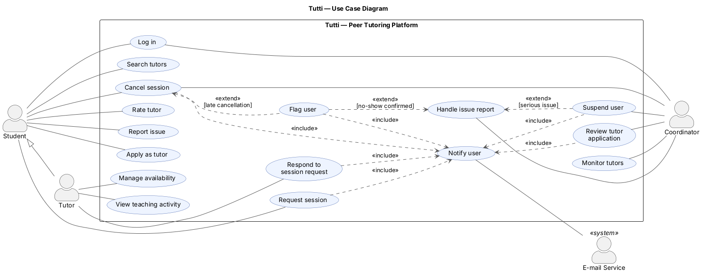

# 2. Develop Use-Case Models (Nikita)

## 2.1 Use-Case Diagram

<!-- Add the use-case diagram image here.
Example:

-->

## 2.2 Actors

| Actor | Type | Description |
|---|---|---|
| Student | Primary | Any enrolled student. Searches tutors, requests and cancels sessions, rates tutors, reports issues, and applies to become a tutor. |
| Tutor | Primary | A student approved for one or more subjects. Specializes Student, so a tutor can also book sessions as a student. |
| Coordinator | Primary | One per faculty. Approves tutors, monitors tutoring, handles issues and suspends users. |
| E-mail Service | Secondary (system) | External service that delivers e-mail notifications. |

## 2.3 Textual Use-Case Descriptions

Use the following structure for each use case. Paste the corresponding descriptions from the team's deliverable and keep the use-case IDs consistent with the diagram.

### UC01 — Log in

- **Actors:** Student (primary), Coordinator (primary)
- **Goal:** Access the platform with the right role.
- **Preconditions:** The user has a university account.
- **Main success scenario:**
  1. User enters university e-mail and password.
  2. System verifies the credentials.
  3. System opens the dashboard for the user's role (Student, Tutor or Coordinator).
- **Extensions:**
  - **2a. Wrong credentials:** System shows an error and the user retries.
  - **2b. Account suspended:** System denies access and shows the reason.
- **Postconditions:** User is authenticated, or access is denied.

### UC02 — Search tutors

- **Actors:** Student (primary)
- **Goal:** Find an approved tutor for a subject.
- **Preconditions:** Student is authenticated.
- **Main success scenario:**
  1. Student selects level (Bachelor/Master), faculty, program and subject, or types the subject name.
  2. System lists active tutors approved for that subject, with their "approved" badge, average rating and free time windows.
  3. Student opens a tutor's profile.
- **Extensions:** **2a. No tutor for the subject:** System shows "No tutors available for this subject yet".
- **Postconditions:** Student sees the matching tutors (or none). Tutors' grades are never shown.

### UC03 — Request session

- **Actors:** Student (primary), E-mail Service (secondary)
- **Goal:** Ask a tutor for a session at a specific time.
- **Preconditions:** Student is authenticated and has opened a tutor's profile (UC02).
- **Main success scenario:**
  1. Student picks a start time inside one of the tutor's free windows.
  2. Student chooses the duration (30, 60, 90 or 120 min), the mode (online/onsite, if the window allows both), the purpose (Introduction, Homework, Exam preparation, …) and writes a description.
  3. System checks the rules: Introduction = 30 min; any other purpose ≥ 60 min; the time is still free.
  4. System creates the request with status *Requested* and blocks that time.
  5. System notifies the tutor.
  6. System shows "Request sent".
- **Extensions:**
  - **3a. Purpose and duration don't match:** System shows the allowed durations and the student corrects them.
  - **3b. Time no longer free:** System shows an error and refreshes the free windows.
  - **4a. Tutor doesn't answer in time:** After 48 h, or 24 h before the session (whichever comes first), the Scheduler marks the request *Expired*, the time is freed and the student is informed by e-mail.
- **Postconditions:** A pending request exists and the time is blocked, or nothing is created.

### UC04 — Cancel session

- **Actors:** Student or Tutor (primary), Coordinator (primary), E-mail Service (secondary)
- **Goal:** Cancel a requested or accepted session.
- **Preconditions:** User is authenticated and is the session's student, its tutor, or the coordinator.
- **Main success scenario:**
  1. User opens the session and selects "Cancel".
  2. User enters a reason (mandatory).
  3. System sets the status to *Cancelled*, records who cancelled and frees the time.
  4. System notifies the other party.
- **Extensions:**
  - **3a. Less than 24 h before the session (student or tutor):** The cancellation is recorded as late and UC16 (Flag user) extends the use case.
  - **1a. Coordinator cancels for a policy violation:** Both student and tutor are notified with the reason.
- **Postconditions:** Session is cancelled and both parties know why. To meet another time, the student sends a new request.

### UC05 — Rate tutor

- **Actors:** Student (primary)
- **Goal:** Give feedback on a completed session.
- **Preconditions:** Student is authenticated; the session is *Completed* and not yet rated.
- **Main success scenario:**
  1. Student opens the completed session.
  2. Student gives a rating (1–5) and an optional comment.
  3. System saves the feedback and updates the tutor's average rating.
- **Extensions:** **1a. Session already rated:** System shows the existing rating; no second rating is possible.
- **Postconditions:** Feedback is stored and visible to the tutor and the coordinator.

### UC06 — Report issue

- **Actors:** Student or Tutor (primary)
- **Goal:** Tell the coordinator about a problem.
- **Preconditions:** User is authenticated.
- **Main success scenario:**
  1. User selects "Report a problem", optionally from a specific session.
  2. User describes the issue (e.g. no-show, inappropriate behaviour).
  3. System creates an issue report with status *Open* and places it in the inbox of the coordinator responsible for that faculty.
  4. System confirms the report was sent.
- **Extensions:** **2a. Description empty:** System asks the user to fill it in.
- **Postconditions:** An open issue report exists in the coordinator's inbox.

### UC07 — Apply as tutor

- **Actors:** Student (primary)
- **Goal:** Become a tutor for one or more subjects.
- **Preconditions:** Student is authenticated and has no pending application.
- **Main success scenario:**
  1. Student opens "Become a tutor".
  2. Student writes a description and selects subjects, entering the grade obtained in each.
  3. System checks that each grade is at least 15/20.
  4. System saves the application with status *Pending* and sends it to the coordinator of the student's faculty.
  5. System shows "Application submitted".
- **Extensions:**
  - **3a. A grade is below 15/20:** System marks that subject as not eligible; the student removes it or cancels.
  - **1a. Pending application already exists:** System shows its status instead of a new form.
- **Postconditions:** A pending application waits for review.

### UC08 — Manage availability

- **Actors:** Tutor (primary)
- **Goal:** Publish the times when students can request sessions.
- **Preconditions:** Tutor is authenticated and approved.
- **Main success scenario:**
  1. Tutor opens the availability calendar.
  2. Tutor adds, edits or deletes a time window and marks it online, onsite or both.
  3. System checks that the window does not overlap another one.
  4. System saves the change and shows the window to students.
- **Extensions:**
  - **3a. Overlap:** System rejects the window and highlights the conflict.
  - **2a. Window contains requested or accepted sessions:** System refuses to delete or shrink it until those sessions are cancelled (UC04).
- **Postconditions:** The tutor's free windows are up to date.

### UC09 — Respond to session request

- **Actors:** Tutor (primary), E-mail Service (secondary)
- **Goal:** Accept or decline a student's request.
- **Preconditions:** Tutor is authenticated; a request with status *Requested* exists.
- **Main success scenario:**
  1. Tutor opens the request (from the e-mail link or the list of requests) and reads the student, date, duration, mode, purpose and description.
  2. Tutor accepts and adds a meeting link (online) or a room (onsite).
  3. System checks that the request is still *Requested* and sets the status to *Accepted*.
  4. System notifies the student by e-mail.
- **Extensions:**
  - **2a. Tutor declines:** Tutor enters a reason; System sets the status to *Declined*, frees the time and informs the student by e-mail.
  - **3a. Request no longer pending (expired or cancelled meanwhile):** System shows "This request is no longer pending"; nothing changes.
- **Postconditions:** Request is accepted with meeting details, or declined with a reason.

### UC10 — View teaching activity

- **Actors:** Tutor (primary)
- **Goal:** Track own tutoring activity.
- **Preconditions:** Tutor is authenticated.
- **Main success scenario:**
  1. Tutor opens "My activity".
  2. System shows upcoming sessions, number of completed sessions, hours taught and ratings received.
- **Extensions:** **2a. No sessions yet:** System shows empty counters.
- **Postconditions:** Read-only.

### UC11 — Review tutor application

- **Actors:** Coordinator (primary), E-mail Service (secondary)
- **Goal:** Approve or reject a student who wants to tutor.
- **Preconditions:** Coordinator is authenticated; a pending application from their faculty exists.
- **Main success scenario:**
  1. Coordinator opens the list of pending applications.
  2. Coordinator reads the description, subjects and grades.
  3. Coordinator approves the application.
  4. System sets it to *Approved*, creates (or extends) the student's tutor profile with the approved subjects.
  5. System notifies the student.
- **Extensions:** **3a. Coordinator rejects:** Coordinator enters a reason; System sets the application to *Rejected* and notifies the student.
- **Postconditions:** The student is a tutor for the approved subjects, or knows why not.

### UC12 — Monitor tutors

- **Actors:** Coordinator (primary)
- **Goal:** Oversee tutoring in the faculty.
- **Preconditions:** Coordinator is authenticated.
- **Main success scenario:**
  1. Coordinator opens the dashboard and drills down: program → subject → tutor.
  2. System shows each tutor's schedule, number of sessions, ratings and student feedback.
  3. System lists flagged users (2 late cancellations or no-shows this semester).
- **Extensions:** **2a. Coordinator spots a problem:** Coordinator continues with Suspend user (UC14) or Cancel session (UC04).
- **Postconditions:** Read-only.

### UC13 — Handle issue report

- **Actors:** Coordinator (primary)
- **Goal:** Resolve a reported problem.
- **Preconditions:** Coordinator is authenticated; an open issue report exists in their inbox.
- **Main success scenario:**
  1. Coordinator opens the issue from the inbox.
  2. Coordinator reviews the description and the related session.
  3. Coordinator contacts the people involved if needed and decides.
  4. Coordinator closes the issue with a resolution note.
- **Extensions:**
  - **3a. No-show confirmed:** UC16 (Flag user) extends the use case for the absent person.
  - **3b. Serious issue:** UC14 (Suspend user) extends the use case.
- **Postconditions:** The issue is *Resolved* with a note.

### UC14 — Suspend user

- **Actors:** Coordinator (primary)
- **Goal:** Stop a student or tutor from using the platform.
- **Preconditions:** Coordinator is authenticated.
- **Main success scenario:**
  1. Coordinator selects the user and "Suspend".
  2. Coordinator enters a reason.
  3. System suspends the account, hides the tutor profile (if any) and cancels the user's future sessions, notifying the other parties.
- **Extensions:** **3a. User has no future sessions:** Only the account is suspended.
- **Postconditions:** The user cannot log in; affected sessions are cancelled.

### UC15 — Notify user «included»

- **Actors:** E-mail Service (secondary)
- **Goal:** Inform a user by e-mail that something changed. All communication is by e-mail; there are no in-app notifications.
- **Preconditions:** Triggered by UC03, UC04, UC09, UC11, UC14 or UC16, or by request expiry.
- **Main success scenario:**
  1. System records the notification (type, subject, body) with e-mail status *Pending*.
  2. System sends it through the E-mail Service to the recipient's university e-mail address (`User.email`).
  3. E-mail Service accepts the message; System sets the e-mail status to *Sent* and records the time.
- **Extensions:** **3a. E-mail Service rejects the message:** System sets the e-mail status to *Failed*.
- **Postconditions:** The recipient has received the e-mail, and the notification is recorded with its e-mail status.

### UC16 — Flag user «extend»

- **Actors:** System behaviour
- **Goal:** Detect students and tutors who repeatedly cancel late or don't show up.
- **Preconditions:** Extends UC04 (late cancellation) or UC13 (confirmed no-show).
- **Main success scenario:**
  1. System adds one to the user's count of late cancellations and no-shows for the current semester.
  2. The count reaches 2.
  3. System flags the user and notifies the coordinator of the user's faculty.
- **Extensions:** **2a. Count is below 2:** The event is only recorded.
- **Postconditions:** The event is recorded; at 2, the user is flagged for the coordinator.
